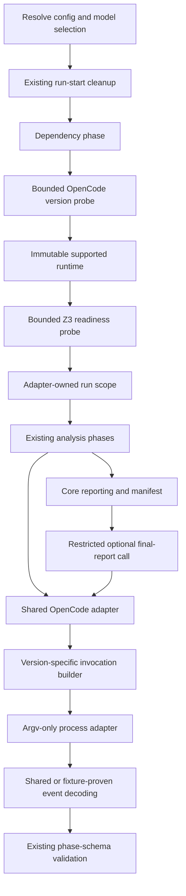

## Context

### Current State

The [proposal](proposal.md) and [compatibility plan](../../../opencodev2-plan.md) define a narrow subprocess-compatibility change. `checkDependencies` currently discards the output of an unbounded synchronous OpenCode availability probe. `callOpencode` constructs v1-shaped model arguments, and final-report execution adds `--pure` and `--dir`. Installed v2.0.15 instead advertises `provider/model#variant` and `--standalone`.

The two delta specifications are [catalog-and-parse](specs/catalog-and-parse/spec.md) and [reporting-and-evidence](specs/reporting-and-evidence/spec.md). They preserve existing optional-report completion and evidence contracts. Implementation and verification progress is recorded in `tasks.md` and `v2-isolation-verification.md`.

### Constraints and Architecture Drivers

- Keep CLI orchestration, deterministic model normalization, and external protocol mechanics in their existing architectural layers.
- Preserve request validation, sequential retries, bounded calls, prompt/attachment identities, schema validation, and output confinement.
- Resolve OpenCode once per normal run without plumbing a version parameter through every domain phase.
- Verify, rather than assume, final-report isolation and provider usability on pinned releases.
- Retain help/version fast paths, `DependencyError` exit 4, `ConfigError` exit 3, and opt-in schema-v1 metrics.

## Goals

- Detect supported installed releases and select the appropriate v1/v2 invocation protocol.
- Keep semantic model/variant selection consistent across CLI input, argv, and telemetry.
- Preserve final-report authority, transport validation, publication, and handled-failure semantics.
- Establish compatibility through focused fake-boundary tests and pinned-release empirical evidence.
- Close the subsequent review findings: owned-process timeout/overflow cleanup, bounded presentation, custom-path citations, production-connected lifecycle/permission evidence, truly opt-in telemetry, efficient decoding/aggregation, and patched development dependencies.

### Review Correction Contracts

- POSIX subprocesses run in an owned process group. Timeout or capture overflow kills that group; a fixed 250 ms cleanup allowance then destroys owned pipes and settles exactly once even if an escaped descendant retains a handle. Descendants that deliberately create another process group are outside group ownership, not evidence of OS containment. Windows uses bounded best-effort `taskkill /T /F`; Windows tree cleanup is not claimed verified by Linux tests. Existing shared OpenCode services are not owned by an invocation.
- The event-loop scheduling assumption is explicit: the timeout plus cleanup allowance bounds pending I/O, not pauses of the Node process itself. Real-process tests check both elapsed time and owned descendant liveness, including parent exit before timeout.
- Capture overflow is a terminal `output_limit` adapter error and cannot trigger a paid retry or per-claim response fallback. UTF-8 validation uses Node >=20's `isUtf8` and preserves strict rejection flags.
- Runtime identity retains the complete canonical version; every displayed version preview is inert and at most 300 characters.
- Telemetry-disabled production runs do not bind a collector or parse/retain usage. Explicit injected collectors remain usable. Collection/publication mode is captured once at run start, so later environment mutations cannot desynchronize the context and metrics writer. Enabled aggregation preserves totals, ordering, scope attribution and schema-v1 snapshot semantics in one attempt pass.
- Citation validity depends on relative-path syntax rather than repository directory names; no claim of referenced-file existence is added. Absolute/drive/UNC paths, URLs and traversal remain invalid. Code fences/comments cannot supply structural evidence. Extensionless root artifacts use explicit Markdown link targets so inline code words such as `sat` or `manifest` are not mistaken for artifact evidence.
- Production calls the final-report coordinator. Generated fault histories execute that same coordinator with independently observed side effects, then compare the terminal facts to the reference model.
- Permission evidence must inspect effective rules/tool exposure and assert a controlled denied operation. An unchanged sentinel or model-authored availability statement alone does not establish enforcement.
- Z3 readiness must be established before any paid analysis. A single bounded `--version` execution rejects every spawn error (including `EACCES`/`EPERM`), signal, nonzero exit, timeout or overflow with actionable dependency exit 4. Mere file existence does not establish executability.

### Non-Goals

No analysis-semantic changes, SDK migration, provider catalog lookup, credential copying, installation management, persistent detection cache, forced-version flag, cross-major fallback, or general ambient-configuration redesign.

## Proposed Design

### System Model



### Component Descriptions

- **Runtime adapter**: bounded detection, canonical release parsing, structured errors, and a scoped immutable descriptor.
- **Model normalizer**: pure base-model/variant validation and fixed Luna/Terra policy, shared by config and adapter boundaries.
- **Protocol builder**: version-specific argv, execution options, and final-report policy serialization. It does not own retry decisions or analysis semantics.
- **CLI orchestration**: maps detection errors to dependency exit 4, emits the selected-version diagnostic, and binds all post-ingestion work to the runtime.
- **Existing OpenCode adapter**: validates requests, resolves runtime, builds invocation once, executes existing retries, decodes responses, validates schemas, and records actual-attempt telemetry.
- **Final-report coordinator**: retains private temporary context, trusted report publication, cleanup, validation, and optional-failure lifecycle.

### System Invariant Tactics

| Invariant | Mechanism |
|---|---|
| No analysis under an unknown major | Complete the bounded dependency probe before any model call; reject majors outside `1 | 2`. |
| One stable runtime per normal run | Return a descriptor from dependency checking, bind it with adapter-owned `AsyncLocalStorage`, and build retry arguments once. |
| No cross-run contamination | No mutable global runtime/cache; scoped contexts and explicit test overrides are independent. |
| No silent variant drift | One pure normalizer feeds config validation, invocation encoding, and semantic telemetry. |
| No malformed request causes a probe | Validate model, prompt, timeout, files, and required final-report controls before direct-call runtime resolution. |
| No authority expansion in final reporting | Version-specific policy serialization plus the discovery gate; shared trusted publication and validation. |
| No completion-semantic change | Keep report failures warning-only after core completion and preserve summary/manifest refresh ordering. |

### Quality Attribute Tactics

Each dependency probe has a fixed 5,000 ms process timeout and 16,384-byte combined capture limit, plus bounded process cleanup. Normal runs perform one OpenCode probe and, after it succeeds, one Z3 probe. Success diagnostics go to stderr, leaving structured stdout progress unchanged. The runtime is a small immutable value, not a persistent cache. Existing concurrency and retry limits remain authoritative.

### Interaction Protocols

#### Runtime Resolution

`detectOpencodeRuntime(binaryPath)` invokes `runProcess(binaryPath, ["--version"], { timeoutMs: 5000, maxOutputBytes: 16384 })` and returns `Result<OpencodeRuntime, OpencodeDetectionError>`.

Dependency checking is asynchronous and returns the descriptor only after both dependencies succeed. The redundant OpenCode `isCommandAvailable` call is removed. The subsequent Z3 correction replaces its synchronous availability check with `probeZ3Dependency(config.z3 ?? "z3")`, using `runProcess(command, ["--version"], { timeoutMs: 5000, maxOutputBytes: 16384 })`. This verifies execution rather than filesystem mode bits, accepts only a signal-free zero exit, and imposes no Z3 release grammar or SMT query. Closed causes are `not_found`, `not_executable`, `spawn_error`, `timeout`, `output_limit`, and `exit_error`. Bounded inert diagnostics identify the configured command and trusted failure reason plus checks for `--z3`/PATH, permissions and filesystem restrictions; raw subprocess output and exception text are omitted. Every failed preflight aborts once with dependency exit 4 and no paid analysis, query, model retry or telemetry attempt.

`runIngestionPhases` carries the resolved descriptor in its result. The CLI then calls `runWithOpencodeRuntime(runtime, operation)` around the remaining pipeline, including source-backed work and post-manifest reporting. Ingestion itself makes no model calls, so this introduces no partially initialized runtime scope and preserves cleanup/dependency ordering. The general synchronous availability helper also rejects all spawn errors and signals; it is no longer the production Z3 preflight.

Runtime selection for a direct adapter call follows these rules:

1. An explicit descriptor takes precedence over ambient scope; its binary is the default command when `binaryPath` is omitted.
2. Otherwise use the scoped descriptor; its binary is the default command.
3. Without either descriptor, detect the explicitly selected binary or `opencode` once for that logical call.
4. If an explicit `binaryPath` conflicts with the selected descriptor, reject it as non-retryable `runtime_error`; never reuse another binary's version.
5. Build arguments before the existing retry loop, and do not detect again on retries.

Use the selected command string consistently as descriptor identity; tests supply exact matching paths. This does not promise equivalence across arbitrary symlink spellings or pin executable bytes. Replacing a binary while a run is active is unsupported. A direct call's failed probe becomes `runtime_error` with its structured cause. It consumes no model retry budget and is not eligible for formalization model-response degradation.

#### Invocation Protocol

| Concern | v1 | v2 |
|---|---|---|
| Bare model | `--model <base>` | `--model <base>` |
| Selected variant | `--model <base> --variant <variant>` | `--model <base>#<variant>` |
| Output | `--format json` | `--format json` |
| Attachments | Repeated `--file <path>` under verified ordering | Repeated `--file <path>` under verified ordering |
| Final-report isolation | Existing `--pure`, subject to pinned baseline verification | Candidate `--standalone`, subject to discovery gate |
| Final-report root | Existing `--dir <isolated-root>` | Process `cwd: isolatedRoot` |
| Final-report agent | `--agent spec-check-final-report`; omit `--auto` | Same |

Keep prompt-as-one-argv-element semantics and the existing UTF-8 prompt bound. Establish correct attachment ordering against each pinned release rather than treating documentation examples as parser proof. Never retry with another major's flags after an execution failure.

#### Final Report Compatibility

Keep final-report policy intent independent of the detected version. Move version-dependent configuration encoding to the protocol boundary; the domain prompt/policy builder supplies semantic instructions, allowed reads, and denied capabilities, not a major-version branch. Adapt the existing final-report configuration seam locally rather than replacing every phase interface with a new general adapter framework.

For v2, serialize `agents`, `system`, ordered `permissions`, `shell`, and `subagent`. Start with deny-all and allow only the required reads/searches and designated external-directory boundaries, retaining existing secret-file exceptions. Keep edit, shell, delegation, web, skills, questions, and other unapproved actions denied. Do not accidentally deny the approved primitive tools by denying a composite execution mechanism they require; verify the actual tools available on the pinned release.

Retain the private `spec-check-final-report-` temporary root, exclusive `0600` `opencode.json`, and handled-path cleanup. Keep `$schema: "https://opencode.ai/config.json"` for editor integration but use v2 documentation for field shapes. Retain `formatter: false`; omit unsupported `lsp`; use native `mcp.servers` if emitted. Empty MCP configuration is not evidence that inherited servers cannot initialize.

For the tested v2.0.15 baseline, use `OPENCODE_CONFIG`, `OPENCODE_CONFIG_CONTENT`, and private `OPENCODE_CONFIG_DIR` with private-server execution, isolated `cwd`, matching `PWD`, and explicit `OPENCODE_CONFIG_PROJECT_DISABLE=1`. V2's run target prefers inherited `PWD` over `process.cwd()`, so setting only subprocess cwd does not establish the intended client location. Discovery recorded in `v2-isolation-verification.md` shows that the native project-disable control excludes ancestor-configured and auto-discovered server plugins and MCP servers before import/startup, while retaining required built-ins and the generated agent. Set the native variable explicitly: it outranks the legacy `OPENCODE_DISABLE_PROJECT_CONFIG` alias, so an inherited native `0` must not defeat exclusion.

The native control is implemented in official v2.0.15 source and validated on that binary, but not currently listed in the user-facing guide; retain pinned-release tests and avoid a blanket claim for every v2 release. Private `OPENCODE_CONFIG_DIR` replaces the server's global root; explicit/inline generated config still loads. Terminal-only/CLI plugins are outside the exclusion contract. Do not use `plugins: []` as a clearing operation or `plugins: ["-*"]` as import exclusion: the former accumulates with earlier sources and the latter removes activation only after import and also suppresses required built-ins. Do not rely on the current guide's top-level `integration.use` policy in v2.0.15, whose decoded config does not retain it.

Existing `XDG_CONFIG_HOME` isolation is retained, but no terminal-plugin exclusion mechanism is added. Provider-backed checks and permanent regression fixtures now establish the accepted local release baseline; the evidence report states its environmental limits. Never place credentials in the generated policy file. Preserve the existing prompt naming the analyzed workspace, strict path/body acknowledgment, atomic trusted publication, and post-publication validation.

#### Compatibility Discovery Gate

Before enabling the v2 final-report path or claiming completion, create `v2-isolation-verification.md` in this change with the tested v1/v2 releases, exact sanitized commands, results, actual config precedence, verified authority boundary, provider authentication mechanism, and any discovered minimum release requirement.

Use disposable controlled environments, without changing real global config, to exercise:

- Each candidate config variable alone and together.
- Global/system and ancestor direct/`.opencode` configs, including ambient instructions.
- A same-name agent override, permissive mutation policy, instruction marker, and harmless plugin/MCP startup marker.
- Approved source/evidence reads, unapproved external-directory denial, and credential-backed report generation.
- Attempted file mutation, shell, delegation, and web access, checking mutation sentinel bytes.

Compare the v1 isolation baseline to v2. Permission tests and startup-marker observations answer different questions: a denied tool cannot establish that an ambient plugin never ran. This gate preserves the existing report contract; it does not assert that no managed policy can ever be loaded. Record which sources load, whether they can alter required authority or initialize unintended integrations, and how the accepted transport preserves the baseline. If the CLI cannot do so, record the blocker and revise this design and protocol scenario before enabling it. A handled optional-report warning is not evidence of compatibility.

#### Event and Telemetry Protocol

Capture sanitized pinned-release fixtures for `text`, `error`, and `step_finish` events. Verify `part.text`, token/cache counters, and cost fields as actually emitted. Keep the shared parser when compatible; isolate demonstrated differences at the boundary. Unknown event types are ignored, not successful responses. Required transport/schema failures remain failures; nonzero process exit or signal overrides any partial valid payload. Final reporting retains strict UTF-8 and no wrapper/fence recovery.

Record base `model` without the suffix, `variant` or `null`, and optional `opencodeMajor?: 1 | 2`. Populate the major for every new production model attempt and preserve it through snapshot serialization. Keep `schemaVersion: 1`; older snapshots lacking the additive field remain usable. The repository currently writes metrics rather than exposing a general metrics reader, so verify backward compatibility through existing snapshot types/fixtures instead of introducing a new persistence reader just for this change. Probe work belongs to dependencies, not attempt/token totals. Final-report attempts remain in memory after the immutable core snapshot. Missing usage fields retain existing incomplete-usage semantics.

### Forward Evolution

The supported-major union and protocol builder are explicit extension points. Unknown majors fail closed. Test results establish a concrete release baseline; this change does not promise identical flags throughout every release in a major or add a deprecation policy.

### Costs

One local version process per dependency per normal run, a small immutable descriptor, focused fixtures, and opt-in live compatibility calls. There is no new runtime dependency or ongoing service managed by `spec-check`.

### Alternatives Considered

- **Change only `--variant`**: leaves final-report invocation and config unadapted.
- **Apply v2 flags universally**: breaks the retained v1 protocol.
- **Try one protocol and fall back to another**: can repeat paid work and hide execution failures.
- **Thread runtime through every phase or replace all imports with adapter instances**: unnecessary signature churn for adapter-owned run metadata.
- **Global mutable detected version**: breaks concurrent-run isolation.
- **Assume standalone equals pure**: does not establish configuration, plugin, or credential semantics.

## Component Design

### Key Components

Add an `opencode-runtime` module with pure release parsing, asynchronous detection, and a scoped runner. Add an `opencode-protocol` module for argv/process options and report config encoding. Extract shared model normalization into a pure domain utility so config validation does not import a side-effecting adapter. Retain `variantForModel` as a compatibility export if existing consumers/tests need it.

### Data Design

```ts
interface OpencodeRuntime {
  readonly binaryPath: string;
  readonly version: string;
  readonly major: 1 | 2;
}

interface OpencodeModelSelection {
  readonly model: string;
  readonly variant?: string;
}
```

#### Release Encoding

Accept only a successful process result: no signal, timeout, output overflow, or invalid-UTF-8 stdout. Normalize CRLF to LF, trim outer whitespace, and require one nonempty line matching the entire grammar in `[CAT-OC-VERSION]`. Accept optional case-sensitive `opencode ` and `v` prefixes, safe-integer `major.minor.patch`, semantic-version prerelease identifiers without numeric leading zeroes, and build identifiers; both suffixes may coexist. Preserve suffixes in canonical `version`, removing only prefixes. Stderr is not a fallback version source.

Detection causes are `spawn_error`, `timeout`, `output_limit`, `invalid_version`, and `unsupported_major`. Classification checks timeout then output overflow, then spawn/exit/signal failure, then UTF-8/grammar validation, then supported major. Diagnostic previews are limited to 300 characters and escape control characters into inert text. Unknown major diagnostics use the standard `[spec-check] DependencyError: ...` envelope and identify supported majors 1 and 2.

#### Model Encoding

Preserve existing valid bare models; apply the existing hard-coded Luna=`max`, Terra=`high` map. For explicit suffixes split at the first `#`, reject an empty base/variant, extra `#`, whitespace, or missing provider/model around the first `/`. Permit additional `/` in the model portion and preserve case without trimming. A matching fixed suffix is accepted; a conflicting suffix is invalid. Other variant/catalog validity belongs to OpenCode.

Config normalization errors use exit 3. Direct invalid model input uses non-retryable `invalid_model`, before any runtime resolution. The shared normalizer provides specific messages for empty variants, extra separators, invalid explicit shape, and fixed-policy conflicts as listed in the governing plan.

### Interface Contracts

- Request validation remains before subprocess work, except existing read-only attachment metadata checks.
- Runtime injection is an explicit optional adapter-call override; production normally uses the scoped descriptor.
- Detection errors in the CLI become `PipelineAbortError("DependencyError", ...)`. Direct resolution failures become `OpencodeError.kind = "runtime_error"`; malformed direct model input becomes `invalid_model`.
- Both new adapter error kinds are terminal. Update closed-union handling and formalization infrastructure classification; do not add redundant inline fallback for them.
- Runtime probing never allocates a logical model call or records token usage.
- Config encoding and argv construction are deterministic for fixed runtime, selection, policy, prompt, and file list.

### Code Map

| Path | Change responsibility |
|---|---|
| `src/adapters/opencode-runtime.ts` | New bounded detection, parsing, descriptor, and run scope. |
| `src/adapters/z3.ts`, `src/adapters/process.ts` | Bounded reason-preserving Z3 readiness probe; reject all availability spawn errors/signals. |
| `src/domain/opencode-model.ts` | New pure semantic model normalization and fixed variant policy. |
| `src/adapters/opencode-protocol.ts` | New version-specific argv/execution/config encoding. |
| `src/adapters/opencode.ts` | Resolve runtime after request validation; reuse invocation in retries; normalize telemetry and errors. |
| `src/cli/config.ts` | Validate effective model with the shared normalizer. |
| `src/cli/pipeline-helpers.ts`, `pipeline-types.ts`, `run-cli.ts` | Async OpenCode dependency result and binding around remaining pipeline. |
| `src/domain/prompts/final-report.ts`, `src/domain/reporting/final-report.ts` | Semantic policy/serialization seam and isolated execution context; preserve publication lifecycle. |
| `src/adapters/telemetry.ts`, `src/domain/reporting/metrics.ts` | Additive major attribution and existing snapshot serialization. |
| `src/domain/formal/formalize.ts` and relevant error helpers | Explicitly classify new errors as non-degradable infrastructure/request failures. |
| `test/contract`, `test/property`, `test/integration`, `test/fixtures`, distribution tests | Focused compatibility, scope, transport, policy, and parity evidence. |
| `README.md`, `docs/design.md`, `ARCHITECTURE.md` | Supported release baseline and durable compatibility boundaries. |

## Failure and Reliability

### Failure Mode Analysis

| Class | Failure | Detection and consequence |
|---|---|---|
| Unsafe input | Malformed explicit model or fixed-variant conflict | Shared pure validation; exit 3 or direct `invalid_model`; zero subprocess work. |
| Fragile external format | Banner/multiline version, malformed UTF-8, unsupported major | Bounded strict probe; dependency exit 4, no analysis. |
| Inadequate control action | Probe hangs or floods output | Existing process timeout/capture termination; no model retry. |
| Process model flaw | Descriptor used for a different/replaced binary | Reject descriptor-command mismatch; document replacement as unsupported. |
| Coordination failure | Concurrent run context or retry protocol drifts | Immutable scoped descriptor, exact binary matching, fixed retry invocation. |
| Inadequate isolation | Ambient policy/plugin loading undermines report boundary | Empirical gate and startup markers before acceptance; revise blocked design. |
| Credential isolation error | Private report cannot authenticate | Verify actual provider use without credential copying before acceptance. |
| Transport drift | Partial response on failure or malformed usage events | Preserve authoritative exit/schema validation and incomplete usage state. |

### Control and Recovery

Fail dependency resolution once with an actionable bounded diagnostic. Do not fall back to an assumed major. Preserve existing transient model retries and backoff; new request/runtime failures terminate without model-response degradation. Preserve final-report handled failure, cleanup, warning persistence, and manifest refresh. Fatal output failures keep their existing exit semantics.

## Operational Concerns

### Observability

Emit one detected-version/protocol stderr line on successful normal-run detection. Keep progress JSON schema stable. Add only semantic major metadata to model attempts; do not log full argv, prompts, credentials, or ambient config contents.

### Deployment and Rollout

Ship through existing npm and bundled artifacts after pinned-release discovery and verification. Publish tested releases and minimum requirements, if found. No new flags, feature toggles, or user config migration are needed. Existing installations/credentials remain user-managed.

### Capacity and Scaling

Probe overhead is one local bounded child per dependency per normal run; direct OpenCode calls outside a run probe once each unless given an explicit descriptor. Existing model/solver concurrency dominates capacity. No new persistent state or background process is owned by `spec-check`.

## Security

This change preserves existing read-only report authority rather than expanding it. Use native v2 permission names and ordering, argv-only processes, private exclusive temporary config writes, existing explicit external-read boundaries, and trusted report publication. Credential availability must be demonstrated without embedding secrets. Disposable ambient-config fixtures establish config precedence and integration-startup behavior separately from tool denial. Provider network communication remains required; denied web access refers to agent tools, not model authentication/inference transport.

## Risks / Trade-offs

- [A tested local release baseline does not establish every managed/provider deployment] -> Retain the verified server-source exclusion strategy, pinned evidence, and opt-in live checks; document environmental limits without weakening tool authority.
- [V1 flag availability varies by release] -> Pin and publish a tested baseline instead of asserting all v1 releases support existing flags.
- [Required runtime metadata is ambient] -> Immutable scoped binding, direct-call override, explicit absence behavior, and interleaved scope tests.
- [Strict version grammar excludes wrappers with banners] -> Fail clearly rather than infer a possibly wrong major; no undocumented override flag.
- [A runtime descriptor cannot freeze executable bytes] -> Document binary replacement during a run as unsupported.

## Migration Plan

1. Establish pinned v1/v2 invocation, event, isolation, and credential evidence.
2. Implement bounded detection/scoping, shared model normalization, and protocol encoding.
3. Enable the v2 report path only after its gate is satisfied, preserving the verified v1 path.
4. Complete focused and full verification, documentation, and distribution parity.

Correct `[CAT-DEPS-OPENCODE]` and `[CAT-DEPS-Z3]` to exit 4 as a normative correction; runtime behavior already uses that category. Existing schema-v1 metrics remain valid with an optional added field. There is no persisted-state migration. Ordinary release rollback uses the previous `spec-check` release; no special rollback mechanism is introduced.

## Verification Strategy

- **Contract**: release grammar, exact bounds/options, error causes and diagnostics, model normalizer, exact per-major argv, direct-call error precedence, attachments, native permission serialization, strict payload and event decoding.
- **Property**: normalized-selection round trips for valid explicit references, deterministic encoding, and interleaved scoped runtimes with different binaries. Keep executable test evidence focused on compatibility invariants.
- **Integration/fault injection**: real process adapter with hanging/verbose/invalid-output fake binaries; one probe per run; independent runs; mismatched descriptors; retry histories; no analysis after dependency failure; existing final-report warning/manifest lifecycle.
- **Pinned-release discovery and opt-in live**: actual CLI flags/config/env behavior, provider use, source/evidence reads, tool denial, startup markers, and strict report transport. Record observations rather than claiming unperformed checks passed.
- **Metrics**: new major metadata and semantic model/variant reconciliation, old snapshots without major metadata, no probe attempts, and unchanged post-manifest snapshot semantics.
- **Distribution and completion**: compiled and bundled fixture parity, `make check`, distribution build, and existing parity verification. Trace every new scenario with `traceSpec(...)`; retain existing identifiers for modified scenarios.

The copied requirement models remain abstract evidence from the existing capabilities; they do not establish actual OpenCode config semantics. No new whole-system formal model is required for this narrow adapter change. If implementation changes executable lifecycle/model behavior, update and recheck the affected existing models rather than silently diverging.

## Open Questions

No blocking question remains for the verified local baseline. Discovery established:

1. V1.19.3 supports the existing pure/directory/variant flags and passed credential-backed read-only report checks with its own session-data directory.
2. V2.0.15 requires private server config, project-discovery exclusion, and matching cwd/PWD; actual source-exclusion and provider-backed authority checks passed. Required built-ins remain usable.
3. Both releases admit the prompt-first/repeated-attachment invocation. Their captured text/error shapes share the existing decoder; missing v2 usage fields remain incomplete telemetry rather than requiring fabricated values.

`v2-isolation-verification.md` records the counterexamples, final gate decision, exact checks, and residual environmental limits. It is measured implementation evidence rather than an assumed result from proposal creation.
