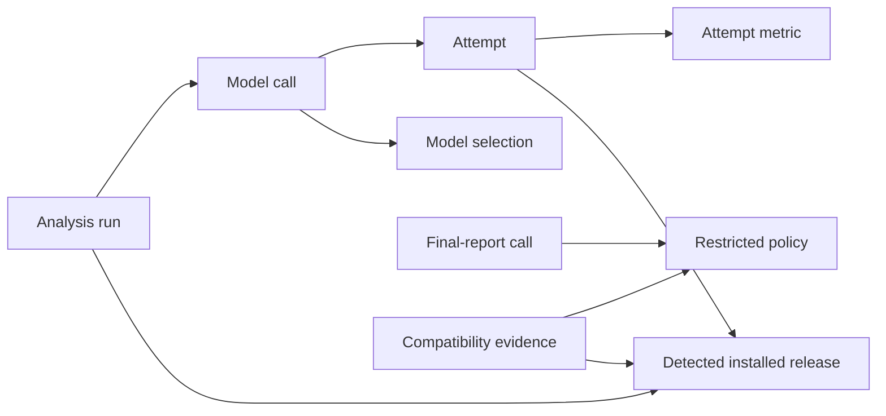

## Motivation

`spec-check` currently invokes OpenCode with a v1-shaped protocol. The installed OpenCode v2.0.15 requires variants in the model reference (`provider/model#variant`) and does not advertise the `--variant`, `--pure`, or `--dir` arguments used by the existing adapter. A run can therefore fail before analysis or fail to produce its optional final assessment.

Support OpenCode v2 while retaining v1 compatibility and the existing read-only, evidence-preserving analysis contract. The governing scope is `opencodev2-plan.md`.

## Scope

### In Scope

- Confirm the installed OpenCode release with a bounded dependency check and accept supported v1/v2 protocol families.
- Reuse one detected release per analysis run, including retries and optional final reporting; isolate concurrent runs.
- Preserve fixed Luna/Terra reasoning variants and accept explicit `provider/model#variant` references with consistent validation and telemetry.
- Select the version-appropriate model, attachment, execution-directory, and final-report configuration protocol.
- Verify that v2 final reporting preserves the existing restricted-agent boundary and credential usability before claiming compatibility.
- Preserve strict final-report transport and existing usage-completeness semantics across tested releases.
- Correct the missing-dependency scenarios to exit 4, matching the established runtime error contract.
- Close the verified Z3 executability gap with a bounded, reason-preserving preflight that blocks paid analysis on an unusable solver.
- Add focused contract/integration evidence, tested-release documentation, and additive OpenCode-major telemetry.

### Out of Scope

- Changes to claim extraction, formalization semantics, solver reasoning, report content strategy, or analysis findings.
- Replacing the subprocess integration with the OpenCode SDK or server API.
- New installation management, credential management, model catalogs, model-policy configuration, version-forcing flags, or cross-major retry fallback.
- Persistent version caching, executable replacement guarantees, v1 deprecation policy, or support for unknown future majors.
- General configuration hardening beyond preserving the existing final-report boundary during this migration.

## Context

### Background

The CLI already checks for external dependencies, but it does not retain the OpenCode release. Reasoning variants and final-report controls are currently encoded directly in the OpenCode integration. Optional final reporting follows core manifest completion; handled failure records a warning without revoking the core evidence bundle.

The installed v2.0.15 CLI confirms the immediate argument differences. The exact supported v1 release baseline and standalone v2 configuration-isolation behavior still need empirical verification. A private server is not, by itself, proof that ambient configuration is excluded.

### Affected Systems and Stakeholders

- Users with locally configured OpenCode v1 or v2 and existing provider credentials.
- The `spec-check` dependency boundary, LLM-backed phases, optional final assessment, and opt-in metrics consumers.
- Maintainers of contract, property, integration, and distribution-parity verification.

### Assumptions and Dependencies

- Users continue to install and configure OpenCode and Z3 themselves.
- OpenCode exposes a parseable release through `--version`.
- Pinned representative v1/v2 binaries are available for compatibility verification; paid provider calls remain opt-in.
- Required final-report isolation can be established with supported controls. If discovery disproves this assumption, revise the design before enabling that path or declaring completion.

### Constraints

- Preserve Node.js >=20, argv-only execution, immutable run configuration, read-only analysis inputs, output confinement, and manifest completion semantics.
- Bound OpenCode version probing to a 5,000 ms process timeout and 16,384 captured bytes, independent of model-call settings.
- Dependency failures use exit 4; malformed effective model references use configuration exit 3.
- Keep help/version dependency-free and preserve current model-call retry/timeout budgets.
- Do not copy credentials into temporary report configuration or empirical verification artifacts.
- Keep the change localized to compatibility and its verification seams.

### References

- [Compatibility plan](../../../opencodev2-plan.md)
- [Technical design](../../../docs/design.md), especially dependency, adapter, final-report, and error contracts.
- [Architecture](../../../ARCHITECTURE.md)
- Active capabilities: [catalog-and-parse](../../specs/catalog-and-parse/spec.md) and [reporting-and-evidence](../../specs/reporting-and-evidence/spec.md).
- [OpenCode v2 CLI commands](https://opencode.ai/v2/docs/cli/commands/)
- [OpenCode v1-to-v2 migration](https://opencode.ai/v2/docs/migrate-v1/)
- [OpenCode v2 config](https://opencode.ai/v2/docs/config/) and [permissions](https://opencode.ai/v2/docs/permissions/).

## Domain Model

| Concept | Meaning and relationships |
|---|---|
| Installed release | The locally selected OpenCode executable's semantic version and supported major protocol family. |
| Analysis run | Owns one successfully detected installed release and many model calls; its release must not leak into another run. |
| Model selection | A base model reference plus an optional reasoning variant, independent of CLI encoding. |
| Model call | Belongs to a phase, uses a release and model selection, and may contain sequential attempts under existing retry rules. |
| Final-report policy | Restricts a report call to approved reads; publication remains the responsibility of `spec-check`. |
| Compatibility evidence | Associates a pinned release with verified invocation, event, credential-loading, and isolation behavior. |
| Attempt metric | Records the semantic model/variant, actual major protocol family, outcome, and available usage evidence. |

## Preconditions, Postconditions, and Invariants

### Preconditions

- Effective CLI/config input is valid and existing run-start cleanup completes before dependency work.
- Before a model call starts, its supported release and valid model selection have been resolved.
- Before v2 final-report compatibility is accepted, pinned-release discovery establishes the required configuration, permission, and credential behavior.

### Postconditions

- A valid v1/v2 installation selects the corresponding protocol, with identical semantic model/variant selection.
- A failed or unsupported version probe prevents analysis with an actionable dependency diagnostic.
- A successful final-report call preserves existing strict transport, trusted publication, and independent validation.
- Opt-in metrics retain existing schema-v1 meanings and add major-version attribution to new attempts.
- Published support claims identify the tested release baseline rather than assuming every minor release supports identical flags.

### Invariants

- Runtime resolution is run-scoped and stable across retries and final reporting; no cross-major fallback occurs.
- Fixed Luna/Terra variants remain enforced, and telemetry agrees with the actual model selection.
- Version probes do not consume model retry budgets or appear as token-bearing attempts.
- Final-report agents cannot mutate files, execute shell/delegation/web tools, or bypass the verified permission boundary.
- Existing manifest, optional-report failure, evidence-preservation, and output-confinement contracts remain in force.

## Failure Modes

- **Unusable or unrecognized installation**: OpenCode is missing, cannot execute, hangs, exceeds the capture limit, or produces an invalid/unsupported release.
  - **Rationale**: Starting paid analysis with an assumed protocol causes avoidable failures and misleading diagnostics.
- **Wrong model or variant**: User input is malformed or conflicts with a fixed reasoning policy.
  - **Rationale**: Silent selection drift changes analysis behavior and invalidates model-cost comparisons.
- **Cross-run protocol contamination**: Concurrent runs reuse another installation's release.
  - **Rationale**: Correct installations would receive incorrect flags nondeterministically.
- **Unpreserved final-report isolation**: Configuration discovery or ambient integrations defeat the restricted report boundary.
  - **Rationale**: Successful text generation alone does not establish the existing read-only contract; compatibility acceptance must be blocked until resolved.
- **Unusable credentials under isolation**: The isolated report call cannot use the configured provider.
  - **Rationale**: A policy that cannot read evidence and generate a report is not a functional compatibility path.
- **Transport or usage drift**: A tested release emits incompatible response or usage events.
  - **Rationale**: Invalid responses must not become accepted evidence, and missing usage must remain visibly incomplete.

## Quality Attributes

- **Compatibility**:
  - **Target/Threshold**: Pinned v1/v2 contract fixtures and compiled/bundled integration paths pass; preserve v1 behavior except the documented malformed-model validation and additive telemetry.
  - **Influence**: Version-specific invocation surrounds shared analysis logic.
- **Bounded responsiveness**:
  - **Target/Threshold**: One version probe per normal run with a 5-second process timeout and 16-KiB capture bound; model retries retain existing limits.
  - **Influence**: Probe failure terminates dependency checking instead of entering analysis retries.
- **Isolation and reliability**:
  - **Target/Threshold**: Concurrent runs retain distinct release identities; final-report policy and ambient-config fixtures establish preserved authority.
  - **Influence**: Explicit run ownership and a release-specific discovery gate.
- **Observability and compatibility of evidence**:
  - **Target/Threshold**: Detected version is diagnosed on stderr; every new model attempt records semantic model, variant, and major; old schema-v1 snapshots remain usable.
  - **Influence**: Normalize model selection once and keep probe work distinct from model usage.

## Capabilities

### New Capabilities

None.

### Modified Capabilities

- `catalog-and-parse`: Bounded OpenCode release detection, supported-major rejection, run-scoped protocol/model selection, and correction of dependency exit codes to 4.
- `reporting-and-evidence`: Version-appropriate restricted final-report invocation, compatibility evidence, and normalized additive telemetry without changing manifest or optional-report semantics.
