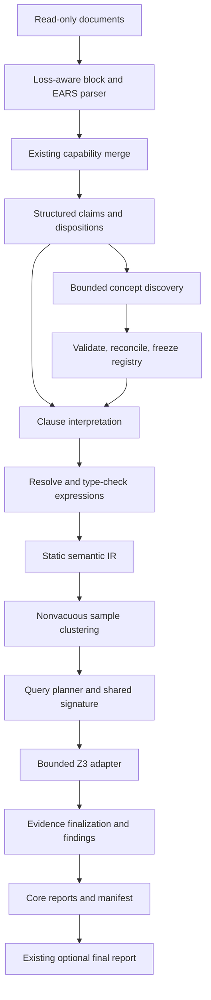

## Context

### Current State

The parser flattens statement and supporting content, classifies EARS by substring presence, and loses clauses before claim formalization. Logic IR declarations have sorts but expressions are opaque strings. Identifier replacement is not literal-aware. Deeper queries ignore unconditional rules and omit durable per-query evidence. Clustering and cross-side queries can redeclare shared symbols. Code-derived requirements bypass source parsing and are marked mandatory. Current completeness wording claims reachability without a transition system.

The [proposal](proposal.md) and [final plan](base-plans/smt_ideas_final_plan.md) authorize an in-place static upgrade. Current version identifiers remain; exact content fingerprints identify the contract used by each run. Temporal BMC and importing input Alloy remain outside this change.

### Constraints and Architecture Drivers

- Preserve semantic grouping, merged-view authority, original eligible-index attribution, bounded transport recovery, and independent source-derived generation.
- Preserve existing read-only, confined-write, append-only finding, error-category, and optional-report lifecycle contracts.
- Follow `docs/lfm.md` and `docs/typescript_style.md`: deterministic domain logic, explicit states, expected failures as `Result`, complete bounds and TSDoc, independent verification.
- Keep schema version fields at their current values. Historical bundles are historical evidence, not inputs to a new compatibility reader; effective configuration and content fingerprints prevent false replay equivalence.

## Goals

- Make source structure and modality authoritative before LLM interpretation.
- Align capability concepts before parallel formalization while exposing uncertain identity and assumptions.
- Compile validated typed predicates through a conservative static semantic IR.
- Produce nonvacuous, precisely scoped static findings with replayable evidence.
- Complete the same semantics on independently derived source-backed claims.

### Non-Goals

- Temporal execution models, reachability, liveness, induction, general input/output realizability, or automated specification repair.
- OWL/RDF, automatic Alloy translation, unrestricted strings, nonlinear arithmetic, general quantifiers, or collection theories.
- Permanent legacy engines, version bumps, or unrelated parser/catalog/merge policy changes.

## Proposed Design

### System Model



### Component Descriptions

1. **Surface extraction** separates statements, references, format justification, scenario metadata/postconditions, fences, evidence, and unmatched content with source spans.
2. **Claim admission** records every extracted statement's disposition and gives eligible claims invocation-local indexes without relying on authored IDs.
3. **Concept discovery** extracts candidates from selected merged statements and explicit model configuration; deterministic reconciliation freezes one registry per semantic group and source side.
4. **Clause formalization** requests predicates for parser-established clauses, then constructs guards, response negation, and modality deterministically.
5. **Expression kernel** parses a closed expression subset, resolves references, checks sorts/units, and renders safe SMT-LIB.
6. **Static analysis** plans background, consistency, activation, pair, advisory, permission, scenario, and coverage queries with explicit applicability and result meaning.
7. **Comparison** operates over semantic IR after independent registry freezing and checked joint alignment.
8. **Evidence coordinator** persists every attempted boundary interaction and exact solver script, then binds completed artifacts into the existing manifest lifecycle.

### System Invariant Tactics

| Invariant | Tactic |
| --- | --- |
| Structure authority | `SurfaceClaim` owns modal and negation; formalization wire payload has clause predicates rather than top-level assertions |
| Immutable vocabulary | Frozen registry/hash is an input to every sample; additions are rejected as unresolved, not merged during worker completion |
| No invented premises | Admit only explicit configured/source-supported background expressions; LLM-proposed background remains candidate evidence |
| Total disposition | Track extracted, eligible, excluded, candidate, error, and interpretation-dependent sets explicitly |
| Identity isolation | Preserve current `claimSet` and original eligible index; a separate source reference identifies pre-eligibility items |
| Typed compilation | Only validated typed nodes reach renderer/query builder; all query signatures share one checked declaration registry |
| Nonvacuity | Check background and comparison premise satisfiability before implication or favorable scope conclusions |
| Modal separation | Mandatory `C` excludes advisory constraints and permissions |
| Evidence completeness | Reserve bounded capture capacity before work; persist exact script/response and final status before publishing a conclusion |
| Completion | New evidence paths join managed cleanup and manifest enumeration; required write failure prevents a new manifest |

### Quality Attribute Tactics

- Canonical serialization and deterministic input-order reconciliation isolate nondeterminism to existing model/solver boundaries.
- Typed source references and spans make source-to-clause-to-expression attribution reviewable.
- A finite-domain reference evaluator is independent of the renderer and solver query builders.
- Query and evidence ledgers expose remaining scope instead of hiding resource limits.
- Reuse existing adapters and private attached-context transport; add no ontology runtime dependency.

### Interaction Protocols

1. Parse original files, apply the existing requirement-block merge, and construct source references and dispositions.
2. For each semantic group, validate explicit analysis configuration and run the bounded discovery pass. Chunking follows stable source order; all chunks finish before reconciliation/freezing. Partial discovery failure blocks only dependent/unresolved formal scope and never silently falls back to private symbols.
3. Freeze and persist the registry. Send the identical registry/hash in attached batches, single-claim calls, degradation calls, and additional samples.
4. Record each raw model response before extraction/validation decisions. Match indexed responses using the existing invocation-local identity contract.
5. Parse each predicate as one complete expression; resolve/type-check; build semantic rules using source-owned structure. Invalid samples consume the bounded attempt budget; missing concepts remain unresolved rather than mutating the registry.
6. Cluster only compatible, background-satisfiable candidates. Track logical inconsistency separately from type invalidity and preserve unstable alternatives.
7. Build deterministic query plans, reserve count/byte/concurrency budgets, execute and persist exact inputs/outputs, and produce typed outcomes.
8. Analyze generated requirements independently through steps 1-7, then align registries and compare compatible nonvacuous artifacts.
9. Render scope and findings; finalize all core evidence and the existing manifest; attempt optional final reporting afterward.

### Forward Evolution

The semantic IR distinguishes `static` rule meaning from future transition-model elements. This change does not add a temporal flag or compile delayed responses as timeless predicates. Explicit time-dependent source content is retained as a temporal limitation; independently meaningful static subclauses may be analyzed only when their extracted scope is recorded.

The surface boundary recognizes unquoted explicit duration drivers (`within`, `after`, `every`, or `for` followed by a numeric duration) and explicit `eventually`/`next state`/`next step` content as limitations. This is a conservative admission guard, not a complete temporal-language classifier or invented timing semantics. Protected display literals are not temporal operators. Other unsupported meaning remains a predicate-interpretation validation obligation; the model prompt must report unsupported content rather than approximate it.

A future temporal change must require `Init`, `Trans`, event occurrence/scheduling, write sets/frames, clock/timing, terminal behavior, correlation scope, and horizon. It must distinguish specification consistency from conformance to a supplied behavior model, avoid assuming its target property, inspect short prefixes/deadlocks, and label pending deadlines at the bound. No milliseconds-to-steps default or inferred transition premises are authorized here.

### Costs

- One bounded discovery pass per original/generated semantic group, potentially composed of stable chunks, adds model calls and registry context tokens to every sample.
- Activation checks are linear in eligible rules; pairwise checks are budgeted; finite-input exhaustive checking is optional and budgeted.
- Raw attempt, normalized IR, and exact query evidence increase storage. Byte limits are admission controls, not permission to silently truncate.
- Measure discovery overhead and analyzed coverage on a fixed corpus; do not promise unchanged runtime, token usage, or findings.

### Alternatives Considered

- **Parallel legacy engines**: rejected by the user's in-development, in-place upgrade decision.
- **Raw SMT strings downstream**: rejected because string rewriting, declaration merging, and syntax reparsing obscure semantics.
- **Growing vocabulary during batches**: rejected because completion order would affect identity.
- **Force all concept candidates into one ontology**: rejected because ambiguity and inferred assumptions must remain visible.
- **Severity-only modality**: rejected because `MAY` would become a required response and advisory rules could invalidate mandatory behavior.
- **Generic Markdown AST rewrite**: unnecessary; retain the constrained line-oriented document parser with explicit fence/metadata states.
- **Unbounded quantifiers to establish realizability**: deferred; static SAT is labeled by its actual existential meaning.

## Component Design

### Key Components

#### Surface grammar and annotations

Core grammar (case-insensitive structural keywords; punctuation inside quoted text/inline code is not a delimiter):

```text
statement   := ubiquitous | state | event | unwanted | complex
ubiquitous  := THE subject modal response DOT
state       := WHILE predicate COMMA ubiquitous
event       := WHEN predicate COMMA ubiquitous
unwanted    := IF predicate COMMA THEN ubiquitous
complex     := WHILE predicate COMMA WHEN predicate COMMA ubiquitous
modal       := SHALL [NOT] | MUST [NOT] | SHOULD [NOT] | MAY
extension   := WHERE predicate COMMA ubiquitous
```

`subject`, `predicate`, and `response` are nonempty spans, not unrestricted expressions parsed deterministically from English. One primary modal is allowed. A statement terminates at the complete sentence boundary before recognized metadata/fences; multiple primary statements or trailing unclassified normative prose make the affected statement ineligible rather than being silently dropped. Decimal points, quoted punctuation, and inline-code identifiers do not terminate a statement. Missing required commas/`THEN`, reversed clauses, empty clauses, `MAY NOT`, unclosed quoting/code spans, and keyword-substring false positives receive precise diagnostics.

`WHERE` is accepted only with `analysis.earsExtensions: ["where"]`; the default is `[]`. No generic `conditional` type or negative-word intent guessing remains. This is a deliberately simplified project profile, not a claim about all canonical EARS compositions.

Recognize `**Format justification:**`, `**Postcondition:**`, and optional `**Scenario kind:** refinement|example|prohibited-example`. A scenario defaults to `refinement`. An explicit example supplies `**Input:**` and either `**Expected:**` or `**Forbidden:**` according to its kind; these natural-language fields become separate predicate slots with source spans. An optional postcondition joins the expected predicate or prohibited conjunction only within that scenario. Missing, unknown, contradictory, or duplicate metadata is preserved and diagnosed. EARS refinement statements use ordinary EARS slots plus a scoped postcondition slot. Fenced Alloy and evidence never become requirement text or admitted assumptions.

#### Explicit analysis configuration

Extend the existing JSON config with optional `analysis` containing `earsExtensions`, original-side `models`, separately authored `generatedModels`, and named resource limits. No new CLI flag is necessary; existing CLI controls retain precedence where already exposed. Original model content is never supplied to generated discovery; separate generated context, when explicitly provided, is labeled configured evidence rather than a source-proven guarantee.

`models` is keyed by capability name (or exact semantic logical-file key for capability-less claims). Each entry can declare concepts/signatures/units, source references for aliases, explicit background expressions, and coverage scopes with an applicability predicate and listed source-rule references. Background and coverage expressions use the same expression kernel; they cannot contain solver commands. Configuration provenance is persisted by file and JSON pointer. Missing models are valid and do not authorize invented constraints.

Explicit concept keys are authoritative. Duplicate keys, conflicting signatures/units, unknown rule references, or unsupported expressions yield localized model-validation findings; invalid JSON/config field shapes remain `ConfigError` exit 3. No external ontology file, implicit archive traversal, or arbitrary new input discovery is introduced.

#### Static query contracts

Let `B` be admitted domain/assumption predicates; `C = and_i (G_i => R_i)` for selected mandatory rules only. Ubiquitous rules have guard `true`. Every rule stores guard and response explicitly; no implication extraction from arbitrary syntax is required.

| Query | Formula / interpretation |
| --- | --- |
| Background | `B`; UNSAT blocks all dependent favorable conclusions |
| Global | `B and C`; SAT establishes only a shared valuation |
| Guard | `B and G_i`; UNSAT is static vacuity under named premises, never temporal unreachability |
| Self-response | `B and G_i and R_i`; UNSAT after a SAT guard identifies an internally infeasible response |
| Activation | `B and G_i and C`; UNSAT after a SAT guard identifies a requirement-set conflict at that activation |
| Pair co-activation | First `B and G_i and G_j`, then add `C`; only SAT then UNSAT establishes that co-activation cannot satisfy the mandatory set |
| Advisory | Check guard feasibility under `B`, then the mandatory baseline with an advisory rule/activation; advisory-only combinations are separate warning-scoped checks |
| Permission | `B and G_p` first, then `B and G_p and C and R_p`; a feasible guard with UNSAT permission identifies a permission/prohibition conflict |
| Coverage | `B and K and not(or selected G_i)`; SAT is an uncovered valuation in the explicit applicability domain/family |
| Positive example | `B and C and input and expected`; SAT witnesses consistency for that example, not universal conformance |
| Prohibited example | `B and C and input and forbidden`; SAT identifies allowed prohibited behavior; UNSAT establishes its exclusion in the admitted model |
| Implication | Satisfiable shared background and premise, followed by `B and A and not(D)`; UNSAT establishes entailment under the checked alignment and premises |

A pair query using `C` may have a core involving other rules; reports attribute the actual sufficient core, not necessarily the selected pair alone. SAT activation or pair queries establish existence of compatible responses, not compatibility for every input in the guard region. Do not equate any SAT witness with `forall input exists output`. Coverage guards are grouped by explicit behavior family; an unrelated unconditional invariant does not supply coverage. Without an explicit coverage obligation, the same search may produce a labeled potential-gap suggestion, not a completeness defect.

Checks whose background/mandatory model is inconsistent or uncertain receive blocked/inconclusive scope statuses. Conflict extraction may continue where its own prerequisites are satisfied; favorable permission/comparison/coverage conclusions may not use inconsistent premises. A failed core-extraction rerun preserves the first verdict with unavailable attribution and both query records; a core is never called minimal without actual minimization.

### Data Design

#### Source and identity

- `SourceRef` consists of invocation claim-set namespace plus original extracted-statement ordinal; authored ID is optional display metadata. `eligibleIndex` is assigned after admission and remains authoritative for existing formalization response matching.
- Spans retain file, start/end line and column, normalized-text offsets, and original-source mapping. Normalize CRLF to LF for parsing while hashing exact selected bytes and recording normalization policy.
- `SurfaceClaim` includes statement clauses, modal, negation, scenario kind/postcondition, supplementary content, source spans, and disposition. It is copied unchanged through selected merge operations.
- Extracted claims partition into admitted and excluded; admitted claims partition into candidate and error on handled completion. Unstable candidates additionally carry interpretation-dependent status. Never key mutable state by authored ID alone.

#### Concepts and assumptions

- Concept IDs use an injective namespace prefix plus either an explicit authored key or a deterministic digest of the candidate's semantic group, defining source anchor, and candidate key. They are stable for identical inputs/fixed discovery responses; no cross-edit or across-model stability is promised for inferred identities.
- Solver names use separate namespaces for concepts, enum sorts/constructors, and assertion labels, then the existing injective identifier encoder. Builtins and generated symbols cannot be shadowed.
- Registry entries contain definition, sort, role, units, scope, aliases, evidence spans, and `explicit|grounded-proposal|unresolved` status. Model-proposed accepted identity is labeled conditional; unresolved alternatives are not equated.
- Reject conflicting explicit declarations; never choose a first-wins semantic identity. Existing compiler merge-conflict handling remains a defensive backstop, not the primary reconciliation policy.
- All admitted assumptions have explicit source/configuration authority. Positive ranges, exclusivity, exhaustive enums, and role classifications are not inferred as hard domain axioms merely because plausible.
- One discovery pass may have bounded stable chunks; reconciliation is deterministic over input order. No automatic discovery/reformalization cycle is included. Missing concepts block dependent samples with preserved proposals.

#### Expression and semantic IR

- Wire responses contain source index, frozen registry hash, and predicates for the exact expected clause slots. Unknown/missing/duplicate slots and attempts to override modality or identity are validation errors.
- Parse a single complete S-expression with an explicit bounded stack. Strings/quoted symbols/comments are lexically recognized so malformed or unsupported forms can be rejected without rewriting literal content. There is no arbitrary script parsing or solver-command AST node.
- Typed nodes include Boolean, integer, rational and enum literals; concept references; typed function applications; Boolean connectives; equality/order; `ite`; addition/subtraction; and multiplication by numeric constants. Validate every operator's actual SMT-LIB arity/type rules for the admitted subset.
- Integers serialize as canonical decimal strings; exact reals as reduced numerator/positive denominator strings. Units are checked separately from SMT sorts; conversions are explicit exact rational scale transformations. Reject unsupported rounding and dimensional operations.
- Unit-bearing expression strings use two closed semantic annotations: `(quantity <numeric-constant> <unit-key>)` and `(convert <numeric-expression> <unit-key>)`. They are not solver operators. The type checker resolves authored units and lowers conversion to exact scalar multiplication (and explicit `to_real` when needed); the renderer emits only the admitted SMT fragment. Bare numeric literals are dimensionless, so adding/comparing them with quantities requires an annotation. Neither aliases nor rounding/conversion factors are inferred. Numerals have an independent 4,096-digit bound to protect exact arithmetic.
- Initial fragment: quantifier-free Booleans, nullary finite enums, linear integer/real arithmetic with explicit coercion, and typed uninterpreted functions over supported sorts. Reject nonlinear products, division/remainder, quantifiers, strings, arrays/collections, recursive datatypes, and time-dependent semantics rather than approximating them.
- Static IR discriminates mandatory rule, advisory rule, permission, background premise, coverage obligation, refinement, example, and prohibited example. Type-valid logical inconsistency is a diagnostic analysis outcome, not a schema error to discard.
- Query signatures include datatype declarations, compatible constant/function declarations, and checked namespaces exactly once. Compare IR directly; SMT-LIB parsing is not a production interchange boundary.

#### Clustering and alignment

The current definition-match relation is exactly `definition.trim().toLowerCase()` equality plus checked role/sort/unit/signature compatibility and ambiguity handling. This is a textual candidate identity rule, not semantic equivalence or Unicode casefold/NFKC. Case-sensitive content can be conflated by this relation; stricter/explicit identity authority is a separate policy decision. This enhancement does not broaden normalization to reduce unmapped scope.

- Compare samples only with the same semantic mode, compatible frozen registry/background, and admitted query fragment. Identify inconsistent samples separately. A single sample has no measured cross-sample stability.
- Unknown equivalence edges do not establish equivalence. Stable representatives retain confidence/scope qualifications; unstable alternatives remain durable, and diagnostic-only representative analyses are explicitly interpretation-dependent rather than authoritative. Representative confidence is a deterministic evidence-quality ordering: prefer fully explicit concept mappings over model-proposed mappings, then source-slot coverage, then original sample index. It is not a probability of natural-language correctness; model-reported confidence cannot override validity, cluster evidence, or source authority.
- Original and generated registries freeze independently. Alignment maps compatible concepts with exact units/scope and records unresolved mappings. Duplicate or incompatible joint bindings produce `incompatible`; absent bindings produce `unmapped`; excluded clauses produce `partial`. These statuses are distinct from semantic `different` and solver `uncertain`.
- Only fully mapped, compatible, satisfiable premise comparisons produce unqualified `same|stronger|weaker|different`. A partial mapped-subset comparison may emit a scoped relation but cannot classify the whole capability as aligned. Preserve direction: generated entails original only means generated is stronger; original entails generated only means weaker.
- Assumptions must match after checked normalization/alignment, or the comparison is `incompatible`; do not silently conjoin stronger assumptions from one side. Explanation remains nonauthoritative for unmapped/incompatible/partial/uncertain results.
- Permission tracks compare explicit allowed valuation relations `P = B and C and G_p and R_p` on each side after alignment. Use `permission-equivalent` for mutual inclusion, `permission-broader` when original P is a strict subset of generated P, `permission-narrower` for the reverse, and `permission-different` when neither includes the other. Establish guard/permission feasibility first; inconsistent or infeasible premises cannot earn equivalence by vacuity. An absent explicit permission is unmapped scope, not a denial or an empty set. Stronger/weaker labels apply only to obligation tracks. Permission differences qualify aggregate alignment and are never silently scored as obligation strength. These relations describe the admitted static valuation space, not projected existential or temporal permission guarantees.

#### Resource bounds and encoding

Initial named defaults, validated before the corresponding work (positive safe integers unless an existing option explicitly permits zero):

| Resource | Default / policy |
| --- | --- |
| Statement bytes | 65,536 UTF-8 bytes |
| Discovery context | 1 MiB per group, stable chunks at most 256 KiB and at most 32 chunks |
| Registry concepts | 2,048 per semantic group |
| Expression | 65,536 bytes, 8,192 nodes, depth 128 |
| Compiled query | 4 MiB |
| Planned solver work | 1,000 executed scripts per group, including background, clustering, auxiliary model/core requests, and comparison allocation |
| Pair candidates | Existing effective `pairBudget` (default 200) per applicable pass, after sound dependency filtering |
| Solver time | Existing 30s primary / 10s static subcheck ceilings |
| Solver concurrency | One shared run-wide pool, maximum 16, including clustering and comparison |
| Model/core capture | 1 MiB decoded evidence per result, within existing process capture bounds |
| Raw model process capture | 8 MiB combined stdout/stderr per attempt, including non-report model phases |
| Durable analysis evidence | 256 MiB per run, reserved conservatively before an attempt/query |

Preserve existing bounded retry/LLM timeout policy and `maxBatchSize` behavior, including `0` disabling physical splitting; it does not disable semantic group, context, expression, or evidence limits. Model truncation/overflow remains terminal under existing adapter contracts. If evidence capacity cannot be reserved, skip new work with an explicit limitation; an actual required write failure is fatal. Preserve all bytes captured within the existing process limit and record terminal overflow rather than claiming a complete response.

The pair allowance counts examinations of the deterministic dependency-filtered candidate prefix, before individual guard/co-activation results. It is not a quota of conflicts, findings, or actual scripts; known-infeasible candidates retain their current position/charge. Advisory examinations are independently bounded, and cross-side comparison retains its specified product-budget gate. Changing eligibility or charging only conflict queries is a separate observable contract change. Unissued dependent plans have blocked/skipped reasons and may be aggregated by count; only actual processes consume `queryScripts`.

Effective expression byte/node/depth limits apply uniformly to source predicates, authored background and coverage applicability. Prepared contexts are keyed by both immutable registry and limit values; a cached permissive result cannot bypass restrictive reuse. Default limits remain configurable as documented, with the existing depth/concurrency ceilings; no new arbitrary byte ceiling is introduced here.

Solver verdict location uses exact standalone top-level lines, accepts LF/CRLF and surrounding whitespace, and ignores verdict text inside quoted/list/comment data. Decoding validates requested scalar identities/values and rejects duplicate bindings; complete/partial/unavailable refer to the exact requested name set. Error/unknown outcomes cannot establish assignment evidence. Exact raw solver bytes remain authoritative evidence.

Completion reconciles the complete `semantic_evidence/` tree against recorder descriptors before every manifest write (including a refresh after optional report failure). Missing/changed/unexpected files, temporaries, symlinks and unsupported file types prevent publication as OutputError. The manifest excludes report.md and duplicate paths, preserving each artifact's original phase rather than appending a second enumeration of semantic evidence. This assumes a local caller-owned single-writer output directory, not race-free traversal of a hostile directory; atomic writes provide lexical confinement/rename, not symlink-free parent resolution.

Check ledgers distinguish disjoint executed/blocked/skipped counts and executed SAT/UNSAT/inconclusive outcomes. `unestablishedQueries` is the explicit aggregate of inconclusive executions and unissued blocked/skipped plans. Compact records carry multiplicity. Sample premise UNSAT is inconsistency; unknown/timeout/error are inconclusive, and admission skip is unassessed.

Canonical JSON uses UTF-8, LF, declared field order, and one trailing newline. Raw response and solver capture files preserve their accepted bytes/text verbatim. Each artifact's descriptor records source/config/prompt/compiler hashes, model/runtime, solver version/options, registry hash, exact semantic mode and feature set. Numeric schema version fields remain current; content identity distinguishes this in-place contract.

### Interface Contracts

- Parser returns structured statements plus loss-aware supplementary/unparsed data; expected source defects are findings, not thrown failures.
- Discovery returns candidate registry/evidence or localized unresolved scope; its frozen result cannot mutate after admission.
- Predicate validation is pure `unknown -> Result<TypedPredicate, ValidationIssue>` with paths and source slot attribution.
- Formalization returns exhaustive candidate/error outcomes over admitted eligible indexes, preserving candidate on additional-sample failure. All-ineligible input returns no model calls and diagnostic completion.
- Query planner returns bounded executable plans and explicit skipped/blocked records. Pure compiler returns only declarations/assertions; query assembly alone appends solver commands.
- Query executor records exact script, stdout/stderr/status, fingerprint, and attribution for every executed script, including failed core/model reruns. Error diagnostics override printed SAT/UNSAT.
- Evidence capture is adapter-owned or injected; domain rules do not gain filesystem/process calls. Required evidence is finalized before dependent verdict publication and before manifest completion.
- Existing `FormalizationError` exit 9 applies to phase-wide failure of attempted eligible formalization; generated-capability failures remain localized. Update the old scenario naming exit 2. Invalid top-level config remains exit 3; evidence persistence remains `OutputError` exit 11.

### Code Map

| Area | Intended responsibility |
| --- | --- |
| `domain/parser/spec.ts`, new `parser/ears.ts` | Document-block extraction and pure strict clause parser |
| `domain/model.ts`, `claim-graph.ts`, `parser/merge.ts` | Rich surface metadata, dispositions, source identity and selected-view propagation |
| New `domain/formal/concepts.ts`, `concept-discovery.ts` | Pure registry/reconciliation and bounded discovery orchestration |
| `domain/logic-ir.ts`, new `formal/expressions.ts`, `expression-parser.ts`, `expression-types.ts` | Semantic types and bounded expression kernel |
| `formal/validate.ts`, `formalize.ts`, batch transport/evidence, prompts | Clause predicates, pinned registry context, attempt capture, identity-preserving recovery |
| `formal/smtlib.ts`, new `formal/signature.ts`, `query-plan.ts` | Safe rendering, shared signatures, bounded query plans |
| `formal/logic-analysis*.ts`, `clustering.ts` | Explicit static checks and nonvacuous sample relationships |
| `code-backwards/gen-formal.ts`, cross-implication modules, new `alignment.ts` | Symmetric parsing, independent registry derivation, checked joint comparison |
| `reporting/`, `adapters/opencode*.ts`, `adapters/z3.ts`, `adapters/fs.ts` | Exact capture, evidence ledgers, confined persistence, strength-aware reports |
| `cli/config.ts`, `run-cli.ts`, `pipeline-helpers.ts` | Controls, stage wiring, global budgets, managed cleanup, existing completion lifecycle |

## Failure and Reliability

### Failure Mode Analysis

| Class | Failure | Detection and effect |
| --- | --- | --- |
| Unsafe inputs / fragile formats | Mixed clauses, malformed metadata, quoting, overlarge expressions, command injection | Bounded parser/type validator returns source-linked issues; no guessed solver meaning |
| Inadequate control | Advisory or permission hardens mandatory baseline | Discriminated semantic tracks and independent finite-domain oracle |
| Process-model flaw | Shared registry freezes a wrong identity or invented assumption | Evidence/status on every mapping; unresolved identities stay separate; no implicit domain axioms |
| Process-model flaw | Existential SAT reported as all-input implementability or reachability | Typed result-strength vocabulary and report acceptance checks |
| Process-model flaw | Inconsistent premises produce vacuous stable/stronger verdict | Background/premise prechecks and inconsistent-candidate classification |
| Coordination | Parallel chunk completion changes registry or claim attribution | Source-order reconcile barrier; registry hash pinned; invocation-local index matching |
| Coordination | Nested pass concurrency exceeds limits | Single executor pool and shared query budget, including reruns |
| Evidence | Captured response/query lost on complete failure | Attempt capture before validation; finalization before failure propagation |
| Evidence | Missing bytes or stale prior-run files appear current | Explicit overflow/skip statuses; managed cleanup; required-write failure prevents manifest |

### Control and Recovery

- Local source/registry/expression failures preserve affected claims and findings; sibling capabilities proceed.
- Additional samples never revoke an existing candidate. Discovery is not repeated automatically to repair a missing concept.
- Zero eligible claims after source admission completes diagnostic reporting with no formal verdict; attempted eligible claims with zero successful candidates retain the existing fatal formalization path.
- Solver errors/unknown/timeouts become explicit inconclusive outcomes, not negative findings or clean checks. Failed auxiliary extraction cannot erase the original recorded query outcome.
- Required persistence failure aborts before successful core completion. Existing optional-report handled warning/manifest-refresh behavior remains unchanged.
- Do not add a new retry layer over existing adapter retries. Budget all actual subprocess attempts and evidence, not just logical calls.

## Operational Concerns

### Observability

Expose discovery/freeze, formalization, query execution, and evidence-finalization progress with stable scope keys and counts. Reports include extracted/admitted/excluded/candidate/error/unstable counts and planned/executed/blocked/skipped/inconclusive checks. Retain opt-in telemetry collection; required semantic evidence is not conditional on telemetry.

### Deployment and Rollout

Ship one static path in place with current version identifiers. Update prompts, config validation, docs, fixtures, and bundled CLI together. Existing user prompt overrides are validated against the new wire contract and fail explicitly if obsolete. Historical outputs are not migrated or presented as new-contract evidence. Rollback is a source/build rollback followed by a fresh managed-output run.

### Capacity and Scaling

Retain the small-repository target. Freeze once per semantic group, reuse typed predicates and signatures, and precompute dependency indexes. Limits bound discovery input, expression depth, enumeration, solver time/concurrency, and evidence. Passing `maxBatchSize=0` does not bypass those bounds. Release evaluation records latency/cost rather than assuming these semantics are free.

## Security

All analyzed source, model descriptions, and attached JSON remain untrusted data. Keep prompts/instructions separate, preserve existing private temp transport and argv-only process boundaries, reject solver commands structurally, and use generated namespaced symbols. No new authentication or network service is introduced. Raw evidence can contain specification/source content: keep it in the configured output, render it inertly, retain the established confinement and non-symlink policies, and never leak original registry/text into source-derived discovery.

## Risks / Trade-offs

- [Strict grammar excludes formerly accepted prose] -> Preserve statements and diagnostics; measure coverage; support explicit justified representations without silently accepting malformed EARS.
- [Shared identity error affects all samples] -> Label model-proposed mappings and conditional stability; preserve unresolved alternatives and author/config authority.
- [Static activation checks miss input-dependent infeasibility inside a SAT region] -> State existential query meaning; finite-domain oracle checks known examples; no claim of general realizability.
- [Discovery adds cost] -> One bounded pass, frozen reuse, and fixed-corpus measurements.
- [Evidence grows] -> Admission-time reservation, bounded capture, visible skipped scope; no silent truncation.
- [Broader contracts touch many tests] -> Stage deterministic kernels first and update explicit behavior expectations rather than preserve byte-identical old findings.

## Migration Plan

1. Land these contracts and their traceability/model plan before implementation.
2. Implement source structures and typed deterministic kernels with semantic fixtures.
3. Add discovery/freeze, predicate prompts, evidence capture, and modal tracks.
4. Replace static query construction/checks and clustering together; remove old reachability wording and unconditional-coverage suppression.
5. Complete generated-side parsing and checked alignment before enabling new-contract source-backed verdicts.
6. Update current schema-v1 transports in place and preserve exact content fingerprints. Retire obsolete prompt payloads explicitly; no legacy runtime path remains.
7. Run verification/evaluation, update living docs and distribution, and archive only after recorded acceptance evidence.

## Verification Strategy

- **Contracts:** table-driven grammar/modal/metadata cases; config/model validity; registry freeze; expression arity/sort/unit/fragment rejection; shared declaration uniqueness; exact query semantics and result-strength labels.
- **Independent semantics:** a small Boolean/enum truth-table evaluator checks rule tracks, permissions, examples, coverage, and implication without calling the production renderer/query planner. Hand-derived arithmetic fixtures check exact boundaries and input-dependent infeasibility limitations.
- **Properties/histories:** source-span round trips, no silent extraction loss, candidate/error partition, render/parse structure preservation, unit conversions, registry/hash determinism under completion permutations, no post-freeze mutations, and concurrent invocation isolation.
- **Real Z3:** declarations, datatypes, linear numbers, guards against unconditional prohibitions, self/three-rule conflicts, inconsistent premises, and malformed input. Query acceptance alone is not a fidelity oracle.
- **Fault injection:** discovery partial failure, every model attempt transport/validation path, additional-sample failure, budget exhaustion, solver overflow/unknown, failed core extraction, evidence write failure, cleanup, and incomplete-manifest behavior.
- **Alloy:** add a small lifecycle/signature/admission model under `models/`; include positive runs and explicit-scope assertions for frozen vocabulary, query prerequisites, nonvacuous outcomes, and evidence-before-completion. Model properties separately from transition facts and report bounded results honestly. Existing affected capability models must be revised where they encode replaced semantics.
- **Release:** `openspec validate improve-ears-smt-analysis --strict`, Alloy checks, `make check`, real-Z3 integration and compiled/bundled parity, plus corpus cost/latency/coverage/inconclusive measurements. Trace every new or changed canonical identifier to meaningful verification.

## Open Questions

No product-policy decision blocks implementation. Initial numeric resource defaults are concrete above; evaluation may justify changes only with updated contracts/evidence. Temporal model authoring, real-time clocks, fairness, and unbounded reasoning belong to the separate temporal proposal.

## Verification Boundary Remediation

The fresh implementation review identified and the user authorized repairs at five
boundaries. Numeric schema versions remain current; new content hashes identify
these semantics.

- The CLI's supplied executor selects typed source-backed coordination even when
  original admission is empty. Generated checks share the same per-capability
  actual-script allowance and run-wide process pool. Missing originals retain
  novel/unmapped comparison scope; empty generation starts no solver work.
- Every predicate request includes parser-owned subject, form and scenario context
  alongside the exact predicate slots. Context informs clause interpretation but
  cannot add slots, declarations, modals, negation, transitions or assumptions.
- Selected typed artifacts carry `single|stable|unstable`, total valid sample count,
  selected input index and cluster membership. Mapping completeness is independent
  of these assessments and proposed-identity dependence. Unstable contributors,
  including mandatory permission baselines, retain diagnostic conditional relations
  but receive no matching credit. Single samples retain explicit no-agreement labels.
- Bounded source scanning captures exact bytes once (30,000 bytes per file and
  100,000 total). Generation attaches exclusive private copies of those bytes,
  not live original paths. Before invocation, managed evidence records the source
  bytes/hashes/path mapping and exact prompt/request identity. Each model attempt
  captures runtime/model/raw outputs and classification through the existing
  evidence coordinator. Refused evidence means unissued scope; required write
  failure means OutputError. Private copies are cleaned after all terminal paths.
- Typed signature rendering emits inert JSON-escaped reversible mapping comments
  for constants/functions and enum sorts/constructors. Comments do not add solver
  commands or change the existing injective namespace encoder.

`models/boundary-remediation.als` abstracts one-capability token charging,
generated-only completion, source capture/edit separation and unstable contributor
credit. It supplements the lifecycle and finite semantic models; it does not prove
production refinement, filesystem atomicity or natural-language fidelity.

The user requires `### State machine and invariant checks` to remain level three
in canonical `catalog-and-parse`. Its pre-existing strict OpenSpec missing-scenario
error is an explicit accepted validation exception, not a green canonical result.
