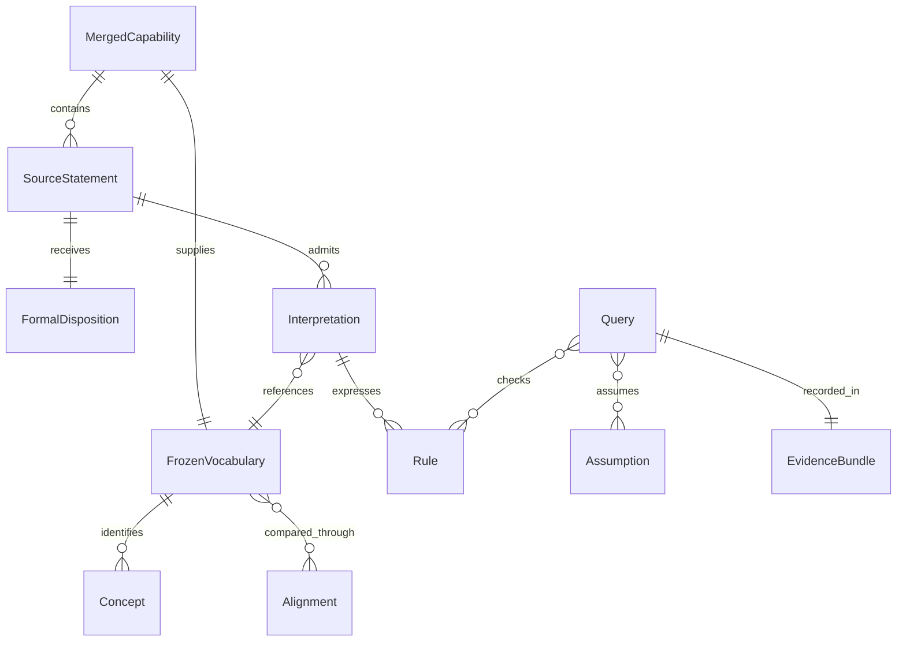

## Motivation

`spec-check` can preserve and solve a logical encoding without establishing that the encoding retains the structure of its source requirement. EARS clauses are flattened before formalization, independent interpretations can disagree about concept identity, and assertion bodies receive shallow validation. Static results also use reachability language despite having no execution model.

These gaps weaken the tool's central value: finding requirement defects before implementation. They can hide conflicts, create false conflicts, misinterpret permissions as obligations, and make incomplete evidence appear conclusive. The project is still in development, so this is the appropriate time to correct the contracts in place rather than maintain competing legacy engines.

## Scope

### In Scope

- A simplified, strict project EARS profile with source-preserving clauses, explicit non-EARS eligibility, structured scenarios, and authoritative source-derived modality.
- A bounded capability concept-discovery stage that separates identity alignment from domain assumptions and freezes a shared vocabulary before formalization.
- Typed, bounded expression validation and a conservative static solver fragment.
- Distinct mandatory, advisory, and permission analysis tracks.
- Static checks with explicit valuation-based meanings: background consistency, global consistency, guard feasibility, activation conflicts, scoped coverage, scenarios, and permissions.
- Nonvacuous interpretation clustering and source-backed comparison using independently derived vocabularies and an explicit alignment boundary.
- Complete formalization and solver evidence, explicit partial scope, bounded work, documented failure behavior, and existing completion semantics.
- OpenSpec contracts, small Alloy models of analyzer invariants, independent semantic oracles, and measurable evaluation evidence.

### Out of Scope

- Temporal BMC implementation, reachability analysis, response-deadline verification, unbounded liveness, fairness, induction, and general reactive realizability. These require a later change with explicit modeling inputs.
- Importing embedded Alloy declarations or facts into the SMT analysis. Alloy remains a separate modeling and verification tool.
- OWL/RDF reasoning infrastructure, unrestricted strings, nonlinear arithmetic, general quantifiers, and quantified collections.
- Automatic requirement editing, code generation, permanent legacy-engine support, or version-number changes.

## Context

### Background

The final plan combines the semantic separation in Plan A, typed-expression discipline in Plan B, and shared-concept insight in Plan C. It supersedes their compatibility assumptions: the user explicitly permits in-place changes with current version identifiers. The first delivery is static; temporal conclusions require explicit authored or configured semantics in a follow-up.

The current compiler already deduplicates compatible declarations. The missing concept-alignment service belongs before formalization, not in declaration deduplication. Implication query assembly separately needs consistent shared signatures to avoid duplicate declarations. Guarded-versus-unconditional and self-conflicts need activation checks beyond the existing implication-pair pass.

### Affected Systems and Stakeholders

- Specification authors receive more precise structural, ambiguity, conflict, and limitation findings.
- Implementers receive inspectable source-to-expression mappings and valuation witnesses rather than unsupported behavioral guarantees.
- Maintainers update parsing, claim normalization, formalization, source-backed comparison, reporting, and their verification contracts.
- Evidence consumers must distinguish completed bundles, partial analyzed scope, interpretation dependence, and inconclusive checks.

### Assumptions and Dependencies

- Inputs follow the project's constrained OpenSpec document conventions.
- Existing bounded OpenCode and Z3 adapters remain available.
- Concept discovery and formalization remain probabilistic interpretation boundaries; solver validity alone cannot establish fidelity to natural-language intent.
- Explicit domain assumptions and coverage expectations may be absent. Their absence must remain visible rather than being filled with unstated premises.
- Capability merge selection remains authoritative before concept discovery and formalization.

### Constraints

- Preserve read-only inputs, output confinement, atomic writes, append-only findings, existing exit-code categories, and post-manifest optional reporting.
- Use current version identifiers. Record content fingerprints and effective configuration to identify the exact analysis contract used by a run.
- Bound all model calls, expression processing, candidate selection, solver work, and evidence capture.
- Preserve independent source-derived generation: original requirement text, registry contents, and assumptions must not feed back into that derivation.
- Document changed behavior and its evidence through the repository's existing OpenSpec and lightweight-formal-methods workflow.

### References

- [Final plan](../../../../smt_ideas_final_plan.md)
- [Review](../../../../smt_ideas_review.md), [Plan A](../../../../smt_ideas_a.md), [Plan B](../../../../smt_ideas_b.md), [Plan C](../../../../smt_ideas_c.md)
- [Technical design](../../../../docs/design.md), [architecture](../../../../ARCHITECTURE.md), [lightweight formal methods](../../../../docs/lfm.md), [traceability](../../../../docs/spec_traceability.md)
- [EARS reference](https://alistairmavin.com/ears/)
- [AWS requirements analysis](https://kiro.dev/blog/deep-spec-analysis/)
- [Claimcheck](https://midspiral.com/blog/claimcheck-narrowing-the-gap-between-proof-and-intent/)
- [SMT-LIB](https://smt-lib.org/language.shtml), [Programming Z3](https://theory.stanford.edu/~nikolaj/programmingz3.html)

## Domain Model

| Entity | Meaning |
| --- | --- |
| Source statement | A requirement or scenario statement with exact location and separated supporting content |
| Formal disposition | Whether and how a statement can participate in formal analysis, including explicit exclusion reasons |
| Concept | A scoped domain meaning with a signature, role, aliases, units, and supporting evidence |
| Frozen vocabulary | The capability's immutable concept registry shared across interpretations |
| Assumption | An explicitly admitted premise, separate from a requirement and from a proposed inference |
| Interpretation | A candidate mapping from source clauses into typed predicates |
| Rule | An activation condition and response with mandatory, advisory, or permission meaning |
| Scenario | A guarded refinement, concrete witness, or prohibited example with associated postconditions |
| Coverage obligation | An explicit expected applicability region and behavior family whose guards should cover that region |
| Query | A precisely scoped solver question with premises, dependencies, and a result-strength contract |
| Alignment | A post-derivation mapping between independently frozen original and code-derived concepts |
| Evidence bundle | Preserved source mappings, interpretations, queries, outcomes, and limitations bound by the core manifest |

## Preconditions, Postconditions, and Invariants

### Preconditions

- Effective configuration and selected merged capability views exist before formal analysis.
- A claim has an explicit eligibility disposition before a model is asked to interpret it.
- A vocabulary is frozen before dependent formalization begins.
- A query has a checked signature, admitted fragment, identified premises, and resource budget before solver execution.

### Postconditions

- Every extracted statement is retained with a formal disposition and source provenance.
- Every eligible attempted claim has exactly one terminal candidate-or-error outcome; additional-sample failures preserve existing candidates.
- Every conclusion identifies analyzed scope, assumptions, interpretation dependence, and evidence.
- Every skipped or inconclusive check remains visible; completion never implies universal formal coverage.

### Invariants

- **Identity:** local claim identity is independent of possibly absent or duplicate authored identifiers.
- **Structure:** model output cannot override source structure, modality, or response negation.
- **Vocabulary:** every batch, retry, and sample uses the same immutable capability vocabulary.
- **Authority:** proposed assumptions and unresolved identities never silently become admitted premises.
- **Typing:** every solver expression is validated, resolved, and inside the supported assembled-query fragment.
- **Modality:** advisory obligations and permissions never constrain the mandatory baseline as required responses.
- **Nonvacuity:** inconsistent premises cannot support favorable implication, coverage, or stability conclusions.
- **Strength:** static valuations are never described as executable or reachable states, exhaustive realizability, or temporal proof.
- **Blindness:** joint alignment occurs after independent derivation and cannot influence that derivation.
- **Evidence:** every executed query and accepted or rejected formalization attempt is auditable, including partial and failed runs.
- **Completion:** evidence writes precede the core manifest; optional final reporting retains its existing derivative lifecycle.

## Failure Modes

- **Malformed or unsupported source**: A statement cannot receive a supported formal interpretation.
  - **Rationale**: Guessing its structure would turn a source defect into a misleading solver conclusion.
- **Mistaken or unresolved concept alignment**: Interpretations equate unrelated concepts or fail to connect aliases.
  - **Rationale**: Identity errors can both hide and invent contradictions; stability under a shared vocabulary is not independent validation of that vocabulary.
- **Invented assumptions**: A plausible domain fact is admitted without explicit support.
  - **Rationale**: Added assumptions can eliminate the very counterexamples the author needs to see.
- **Ill-typed or unsupported interpretation**: A model returns an invalid expression or unsupported theory combination.
  - **Rationale**: Such output cannot support a logical finding and must be distinguished from an actual requirement conflict.
- **Vacuous agreement**: Inconsistent premises make distinct interpretations mutually imply one another.
  - **Rationale**: An impossible specification must not receive a stable or stronger verdict.
- **Partial analysis presented as clean**: Exclusions, exhausted budgets, or solver uncertainty disappear from assessment.
  - **Rationale**: Users otherwise mistake absence of findings for evidence of correctness.
- **Cross-side contamination**: Original vocabulary influences source-derived guarantees.
  - **Rationale**: The independent comparison would merely reproduce the intended answer.
- **Missing replay evidence**: A conclusion survives without the exact interpretation or query that produced it.
  - **Rationale**: Reviewers cannot distinguish a specification defect from a translation or query defect.
- **Loss of required analysis or persistence**: All eligible formalization attempts fail, or required evidence cannot be written.
  - **Rationale**: The run cannot publish a successful core completion marker for an untrustworthy bundle.

## Quality Attributes

- **Semantic reliability**:
  - **Target/Threshold**: Every acceptance-corpus case has the specified logical outcome and strength label; zero favorable conclusions from inconsistent premises.
  - **Influence**: Separate assumptions, modalities, scenarios, and query contracts.
- **Determinism**:
  - **Target/Threshold**: Fixed boundary responses and identical selected inputs yield identical semantic artifacts and ordered outcomes under shuffled worker completion.
  - **Influence**: Freeze vocabulary before parallel work and use deterministic identities and reconciliation.
- **Bounded responsiveness**:
  - **Target/Threshold**: Every processing stage and external call has a named size, count, timeout, or concurrency bound; every exhausted budget produces a visible scope limitation.
  - **Influence**: Budget query planning, discovery, retries, and evidence volume explicitly.
- **Auditability**:
  - **Target/Threshold**: Every executed query and formalization attempt has durable source-linked evidence; every completed core artifact is checksummed.
  - **Influence**: Preserve exact inputs and outputs separately from compact indexes and summaries.
- **Isolation**:
  - **Target/Threshold**: Zero original-spec content reaches code-derived generation or registry discovery; zero writes to input trees.
  - **Influence**: Independent vocabularies and explicit post-derivation alignment.
- **Evaluation efficiency**:
  - **Target/Threshold**: Release evidence reports discovery token cost, latency, accepted formal coverage, and inconclusive rate on a fixed corpus, with no silent truncation to meet a cost target.
  - **Influence**: Measure the new pre-pass rather than assume unchanged runtime or cost.

## Capabilities

### New Capabilities

None. The change strengthens the existing analysis capabilities.

### Modified Capabilities

- `catalog-and-parse`: strict source-preserving EARS and scenario parsing, extension policy, escape-hatch eligibility, and source defects.
- `claim-graph-and-coverage`: structured claims, authoritative modality, explicit dispositions, and source-identity preservation.
- `formalization-and-logic-analysis`: frozen vocabulary, typed predicates, modal semantics, nonvacuous clustering, static query contracts, and bounded scope.
- `source-traceability-and-code-backwards`: symmetric generated-claim parsing, independent vocabularies, checked alignment, and evidence-qualified comparison.
- `reporting-and-evidence`: exact attempt/query persistence, content identity, analyzed-scope reporting, strength labels, and failure/completion semantics.
- `merged-capability-analysis`: preservation of statement structure and dispositions across merged views, with merge selection remaining authoritative.
